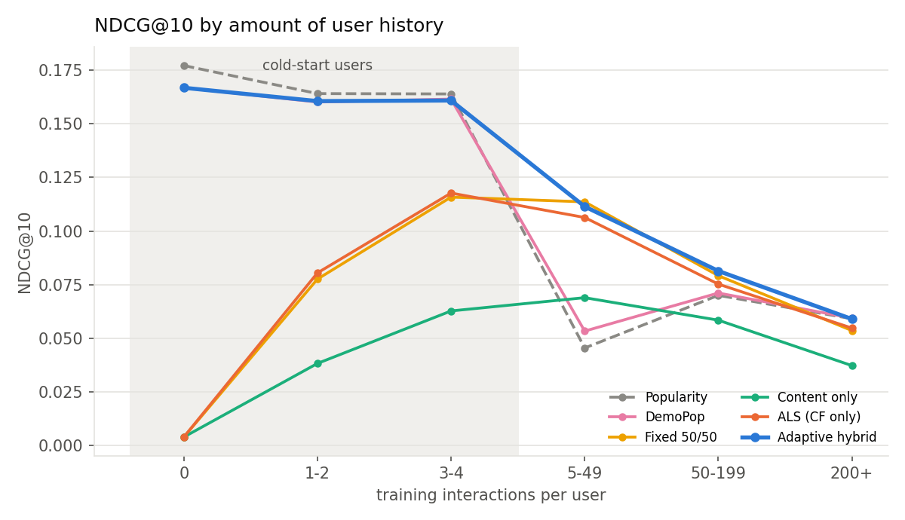

# Hybrid recommender with cold-start handling (MovieLens 1M)

A hybrid recommender that blends **implicit-feedback matrix factorisation (ALS)**
with **content-based** and **demographic** signals through a learned
*confidence gate*. As a user's or item's interaction history thins out, weight
moves smoothly from collaborative filtering to content and demographics, rather
than a fixed 50/50 mix. Everything is evaluated with ranking metrics
(Precision@K, Recall@K, NDCG@K) on explicitly constructed **cold-user** and
**cold-item** slices, plus warm users.

**Write-up:** [REPORT.md](REPORT.md) covers the approach, key decisions,
results and failure analysis.
**All generated numbers:** [results/summary.md](results/summary.md) ·
[results/metrics.json](results/metrics.json) · [results/figures/](results/figures)

### Headline results (NDCG@10, mean of 3 seeds)

| model | all users | warm users | cold users (< 5 ratings) | cold items (< 5 ratings) |
|---|---|---|---|---|
| Popularity | 0.0749 | 0.0583 | 0.1669 | 0.0216 |
| ALS (CF only) | 0.0827 | 0.0840 | 0.0755 | 0.0603 |
| Fixed 50/50 CF + content | 0.0862 | 0.0884 | 0.0736 | 0.2819 |
| **Adaptive hybrid** | **0.1005** | **0.0894** | 0.1620 | **0.3991** |

The hybrid is +34% over popularity and +17% over a fixed 50/50 mix overall. It
does not break for new users (2.2× pure CF) or for new items (6.6× pure CF), and
it adds a diversity/novelty re-ranker as a bonus.



## Repository layout

```
├── README.md                  ← you are here
├── REPORT.md                  ← 2-page write-up: approach, decisions, results, failure analysis
├── requirements.txt
├── scripts/
│   └── run_experiment.py      ← one command reproduces every table and figure
├── src/hybridrec/
│   ├── data.py                ← downloads + parses ML-1M; joins the ML-25M tag genome by movie id
│   ├── split.py               ← chronological split that manufactures cold users and cold items
│   ├── features.py            ← item content blocks (genre, year, title TF-IDF, tag genome), demographics
│   ├── models.py              ← Popularity, DemoPop, ImplicitALS, ContentProfile, Fixed & Adaptive hybrids
│   ├── metrics.py             ← vectorised Precision/Recall/NDCG/HitRate@K, coverage, novelty, ILD
│   ├── evaluate.py            ← evaluation protocols and slicing
│   ├── rerank.py              ← MMR diversity/novelty re-ranking (bonus)
│   ├── experiment.py          ← split → tune on validation → refit → evaluate → ablations
│   └── analysis.py            ← aggregation across seeds, figures, failure analysis
├── tests/test_core.py         ← unit tests (metrics, split invariants, gate behaviour, MMR)
└── results/                   ← generated outputs (committed so reviewers need not re-run)
```

## Setup

Requires Python ≥ 3.10. No compiled recommender libraries are needed: ALS is
implemented in NumPy, so it installs cleanly on Windows, macOS and Linux.

```bash
git clone https://github.com/gurusamiv2025-jpg/hybrid-recsys.git
cd hybrid-recsys
python -m venv .venv
source .venv/bin/activate          # Windows: .venv\Scripts\activate
pip install -r requirements.txt
```

### Data

Nothing needs to be downloaded by hand. On first run the script fetches:

| file | size | used for |
|---|---|---|
| [`ml-1m.zip`](https://files.grouplens.org/datasets/movielens/ml-1m.zip) | 6 MB | ratings, movie genres/titles/years, user demographics |
| [`ml-25m.zip`](https://files.grouplens.org/datasets/movielens/ml-25m.zip) | 262 MB | **only** the tag genome (1,128 tag-relevance scores per movie), joined to ML-1M by movie id |

Both go into `data/`. The genome slice for ML-1M movies is cached as
`data/genome_ml1m.npz` (≈10 MB), so the large zip can be deleted afterwards.
GroupLens throttles each connection, so the downloader fetches large files with
parallel HTTP range requests. Pass `--no-genome` to skip ML-25M entirely.

By using the data you agree to the [GroupLens usage licence](https://files.grouplens.org/datasets/movielens/ml-1m-README.txt).

## Reproducing the results

```bash
python scripts/run_experiment.py
```

This runs 3 seeds and regenerates `results/` (summary tables, JSON, figures,
per-user metrics). It takes about 45 minutes on a laptop CPU (≈15 min per seed:
ALS grid ≈2 min, gate search ≈8–12 min, evaluation and ablations ≈3 min).

| option | effect |
|---|---|
| `--quick` | tiny search grids, 1 seed: a sanity run in ~4 min |
| `--seeds 0 1 2 3 4` | choose seeds (results report mean ± std across seeds) |
| `--no-genome` | content = genre + year + title only (no ML-25M download) |
| `--horizon 0` | judge users on *all* held-out interactions instead of the next 20 |
| `--k 20` | change the cut-off K (K and 2K are both reported) |
| `--out-dir DIR` | write outputs somewhere other than `results/` |

### Re-running only the evaluation

All randomness is seeded (split, ALS initialisation, gate search, tie-breaking),
so re-running a seed reproduces the same numbers. To evaluate a different
configuration without touching the defaults, use a separate output directory:

```bash
python scripts/run_experiment.py --seeds 0 --no-genome --out-dir results_no_genome
```

Programmatic use, e.g. to evaluate your own model on the same slices:

```python
from hybridrec.data import load
from hybridrec.split import make_split
from hybridrec.features import build_train_data
from hybridrec.evaluate import COLD, make_eval_set, evaluate_scores, score_batched

ml = load("data")
split = make_split(ml.ratings, seed=0)
data = build_train_data(ml, split.train)
es = make_eval_set(data, split.test, candidates=data.item_counts >= COLD, horizon=20)
scores = score_batched(my_model.score, es.users)        # (n_users, n_items) array
per_user, _ = evaluate_scores(scores, es, k=10)          # precision / recall / ndcg / hit per user
```

### Tests

```bash
python -m pytest -q
```

The tests use synthetic data and need no download. They check hand-computed
metric values, split invariants (no train/test overlap, cold users keep only
their earliest ≤ 4 ratings), that the gate shifts weight with history and nests
the fixed 50/50 blend, and that MMR with λ = 1 is the identity.

## Method in one paragraph

Five components are each scored per user and z-normalised: **ALS** (Hu, Koren
& Volinsky 2008) on confidence-weighted implicit feedback; a **ridge mapping
from item content to ALS item factors** so that unseen items still get a
latent vector; a **content profile** (rating-weighted sum of the item vectors
built from genre, decade, title TF-IDF and tag genome); **demographic
popularity** (naive-Bayes item popularity conditioned on gender, age and
occupation); and global popularity as a baseline. A **gate** turns each user's
and item's training-interaction counts into blend weights, using Hill curves
whose six constants are tuned by random search on a validation split carved
from training data only. Details and rationale are in [REPORT.md](REPORT.md).

## Notes for reviewers

- **Two evaluation protocols, on purpose.** User slices (warm and cold users)
  are ranked over the *warm* catalogue; item cold-start is ranked over the
  *cold* catalogue. An earlier version mixed them. Because the split moves
  nearly all of a cold item's ratings into test, about 30% of every warm user's
  held-out likes became cold items, and the numbers were dominated by that
  artifact. REPORT.md §2 explains this.
- **Common horizon.** Each user is judged on their *next 20* held-out
  interactions. Without this, cold users (whose entire future is held out)
  have relevant sets about 10× larger than warm users, which inflates
  popularity. `--horizon 0` turns it off.
- **Absolute NDCG is not comparable across slices.** Cold users are evaluated
  at the very start of their MovieLens history, where the sign-up flow shows
  popular films. Compare models *within* a slice.
- **Tag-genome caveat.** The ML-25M tag genome is computed from MovieLens
  users' tags and ratings, so for "new" items it acts like rich *external*
  metadata, e.g. a licensed back-catalogue title. It is also partly derived
  from the same community's behaviour, so the genome cold-item numbers are an
  optimistic upper bound. The leak-free "brand-new release" scenario (genre,
  year and title only) is reported separately in
  [results/no_genome/summary.md](results/no_genome/summary.md).
- **Trade-offs I made.** The gate is a 6-parameter parametric curve rather than a
  learned model (e.g. a GBDT on per-pair features). It is interpretable, cannot
  overfit badly, and nests the fixed 50/50 blend, but it cannot condition on
  anything except interaction counts. Tuning uses a macro-average of warm,
  cold-user and cold-item NDCG so the numerically dominant warm users do not
  decide everything.
- **What I would do next** is listed at the end of REPORT.md: learned gating,
  real plot-description embeddings (e.g. TMDB overviews with a sentence
  encoder), a global temporal split, and calibrated popularity debiasing.
