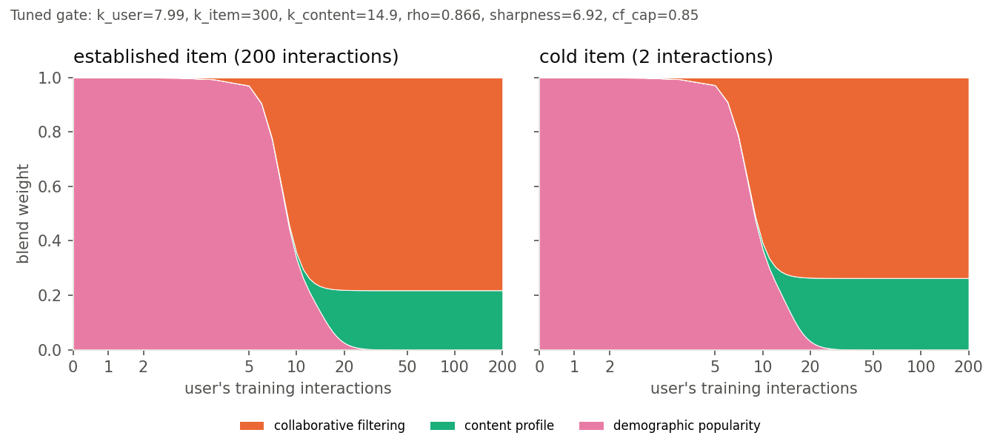

# Hybrid recommendation with cold-start handling: write-up

**Dataset:** MovieLens 1M (6,040 users, 3,706 rated films, 1M ratings) plus the
ML-25M tag genome joined by movie id. **Metric:** NDCG@10 unless stated
otherwise; Precision@10 and Recall@10 are in
[results/summary.md](results/summary.md). Numbers are means over 3 seeds, and
the std across seeds is ≤ 0.002 on every user slice.

## 1. Approach

| component | what it does | cold-start role |
|---|---|---|
| **ALS** | implicit-feedback MF (Hu et al. 2008), 64 factors, confidence `1 + α·r/5`, tuned on validation (α = 10, λ = 100 on all seeds) | the base model for warm users |
| **Content → factor map** | ridge regression from item content vectors to ALS item factors, fitted on items with ≥ 20 interactions | gives unseen items a latent vector, so CF can still score them |
| **Content profile** | user vector = Σ (rating − 2.5) · item content vector; item vector = weighted genre, decade, title TF-IDF and **tag genome** blocks | personalisation from a handful of ratings |
| **Demographic popularity** | naive-Bayes popularity conditioned on gender, age and occupation | the only signal for a user with zero ratings |

**The gate.** Each component's scores are z-normalised per user, then blended
with weights that depend on how much evidence exists:

```
alpha_u = hill(n_u; k_user, s)     trust in the user's CF factors      hill(n;k,s) = n^s / (n^s + k^s)
gamma_u = hill(n_u; k_content, s)  trust in the user's content profile
beta_i  = n_i / (n_i + k_item)     trust in learned vs content-mapped item factors
CF      = beta_i·<p_u,q_i> + (1-beta_i)·<p_u,q̂_i>
w_cf = cf_cap·alpha_u·(beta_i + (1-beta_i)·rho),  w_cb = (1-w_cf)·gamma_u,  w_pop = (1-w_cf)·(1-gamma_u)
```

The six constants are tuned by seeded random search (200 draws, then 2 rounds of
local refinement) on a **validation split carved from training data only**. The
objective is the macro-average of warm-user, cold-user and cold-item NDCG. The
gate nests the fixed 50/50 blend as a special case, which is always evaluated as
an anchor, so on validation the tuned gate can never lose to it.



The tuned gate (seed 0) makes a **sharp handover** (sharpness ≈ 7): users with
≤ 5 ratings get almost pure demographic popularity, CF takes over around 8–10
ratings, and about 20% content weight stays even for heavy users (`cf_cap` = 0.85).

## 2. Evaluation design (key decisions)

1. **Simulated cold start.** ML-1M only contains users with ≥ 20 ratings. So
   15% of users keep only their first 0–4 ratings (chronologically), and 10% of
   items with ≥ 20 ratings keep only their first 0–4. Warm users get a per-user
   chronological 80/20 split. Slices are defined from *actual* training
   counts: cold means fewer than 5 interactions.
2. **Two disjoint protocols.** User slices are ranked over the warm catalogue,
   and item cold-start is ranked over the cold catalogue. My first version
   mixed them. Because the split moves nearly all of a cold item's ratings into
   test, about 30% of warm users' held-out likes became cold items. That
   artifact made content-only look *better than ALS* on warm users. Separating
   the protocols removed it.
3. **Common 20-interaction horizon.** A cold user's whole future is held out,
   so their relevant sets were about 10× larger than warm users', which
   inflates popularity. Every user is now judged on their next 20 held-out
   interactions.
4. **Ranking metrics with masking and tie-breaking.** Seen items are excluded,
   and a tiny seeded jitter stops a model with flat scores (CF for a zero-history
   user) from being rewarded by item-id order.
5. **The tag genome is optimistic for item cold start.** It is computed from
   MovieLens users' tags and ratings. It is realistic for a *licensed catalogue
   title* that already has rich external metadata, but not for a brand-new
   release. So I also report a leak-free run with genre, year and title only
   ([results/no_genome/](results/no_genome/summary.md)).

## 3. Results

| NDCG@10 | all users | warm users (≥ 5) | cold users (< 5) | cold items (< 5) |
|---|---|---|---|---|
| Popularity | 0.0749 | 0.0583 | **0.1669** | 0.0216 |
| Demographic popularity | 0.0772 | 0.0620 | 0.1621 | 0.0169 |
| ALS (CF only) | 0.0827 | 0.0840 | 0.0755 | 0.0603 |
| Content only | 0.0558 | 0.0589 | 0.0387 | 0.2786 |
| Fixed 50/50 (CF + content) | 0.0862 | 0.0884 | 0.0736 | 0.2819 |
| **Adaptive hybrid** | **0.1005** | **0.0894** | 0.1620 | **0.3991** |
| *Adaptive hybrid, leak-free content* | *0.0980* | *0.0866* | *0.1617* | *0.1503* (vs 0.0686 for Fixed 50/50) |


- **Overall:** +34% over popularity, +22% over pure ALS and +17% over the fixed
  50/50 blend.
- **Cold users:** pure CF and the fixed blend collapse to ~0.075; the hybrid
  more than doubles that (0.162). It matches demographic popularity but stays
  3% below *global* popularity. Demographic conditioning slightly hurts here,
  so its shrinkage should be tuned.
- **Cold items:** CF alone barely works (0.060). The content → factor map plus
  content profile reaches 0.399, which is 1.4× the fixed blend. Without the
  genome it reaches 0.150, still 2.2× the fixed blend: genre, decade and title
  alone, routed through ALS factor space, carry real signal.
- **Warm users:** the hybrid is level with the fixed blend (+1%, within noise)
  and +6% over ALS. Some content always helps on this data, which is why the
  tuner set `cf_cap` < 1.
- **Ablation:** for cold items, genre alone gives 0.109, adding decade and title
  gives 0.138, and the genome gives 0.400. With the genome present, the
  genre and title blocks add nothing.

**Bonus: diversity/novelty re-ranking (MMR on the top 100).** λ = 0.7 raises
intra-list diversity from 0.614 to 0.649 for −1.2% NDCG. Adding a novelty term
(weight 0.3, λ = 0.5) raises catalogue coverage from 24.9% to 29.5% for −6% NDCG
([figure](results/figures/mmr_tradeoff.png)).

## 4. Failure analysis: where it still recommends poorly

1. **Niche taste is the biggest driver of failure.** Split users into quartiles
   by how mainstream their held-out likes are. Warm-user NDCG goes from 0.146
   (most mainstream) to 0.048 (most niche), and 74% of the most-niche quartile
   get *zero* hits. The hybrid's top-10 sits at the 97th popularity percentile,
   while what users actually like next sits at the 85th–89th. Popularity is
   baked into ALS, the popularity prior and the z-scored blend. The MMR novelty
   term only partly corrects it.
2. **Cold users get almost no personalisation.** Users with 1–4 ratings share
   28% of their top-10 on average, against 4% for warm users, and only 100
   distinct films are recommended across ~700 such users. The tuned gate
   ignores their ratings because, *on average*, content and CF from ≤ 4
   ratings score far below popularity (0.04–0.12 vs 0.16). Example: user 3371
   rated *One Flew Over the Cuckoo's Nest* 5★ and *Forrest Gump* 3★, and was
   recommended Star Wars, Jurassic Park and Terminator 2. Their next likes
   were *The Godfather*, *Chinatown*, *Citizen Kane* and *Double Indemnity*. A
   gate that sees only *counts* cannot tell an informative 5★ classic from a
   noisy rating.
3. **Taste drift.** Per-user NDCG falls as the genre distribution of what users
   like next diverges from their history (Spearman ρ = −0.19 for warm users).
   User 3122's training history is mostly disliked 1999–2000 releases; they later
   turn to film noir (*Laura*, *Out of the Past*), which a history-fitted model
   cannot anticipate.
4. **Cold items with generic metadata.** The worst-ranked cold items are
   single-genre "Drama" art-house titles (*Rebel Without a Cause*, *Richard III*,
   *My Own Private Idaho*: 0% hit rate). The best are blockbusters (*The Matrix*
   71%, *E.T.* 62%). This is partly genome leakage: the genome encodes how
   well-known and acclaimed a film is. The 5% of items with no genome vector
   get a 1–2% hit rate against 24–30% with one. Content cold start is only as
   good as the metadata.
5. **Heavy users (200+ ratings).** The hybrid only matches popularity (0.059),
   and ALS and the fixed blend fall *below* it (0.055 and 0.054). These users
   have exhausted the head of the
   catalogue, and their next items are long-tail films the models
   systematically under-rank (see point 1).

## 5. Limitations and next steps

- Replace the count-only gate with a **learned gate**: a small GBDT or MLP over
  `n_u`, `n_i`, profile entropy, rating variance and score margins. That
  addresses failures 2 and 3.
- Use real **description embeddings** (TMDB overviews through a sentence
  encoder) for a leak-free semantic content signal for brand-new releases.
- Use a **global temporal split**. The per-user split lets popularity counts see
  other users' "future" ratings, which flatters popularity-based models.
- Add **calibrated popularity debiasing** (e.g. inverse-propensity weighting
  or calibration re-ranking) to target failure 1 directly, and tune the
  demographic shrinkage on validation.

**Reproduce:** `python scripts/run_experiment.py` (~45 min, 3 seeds). See
[README.md](README.md).
